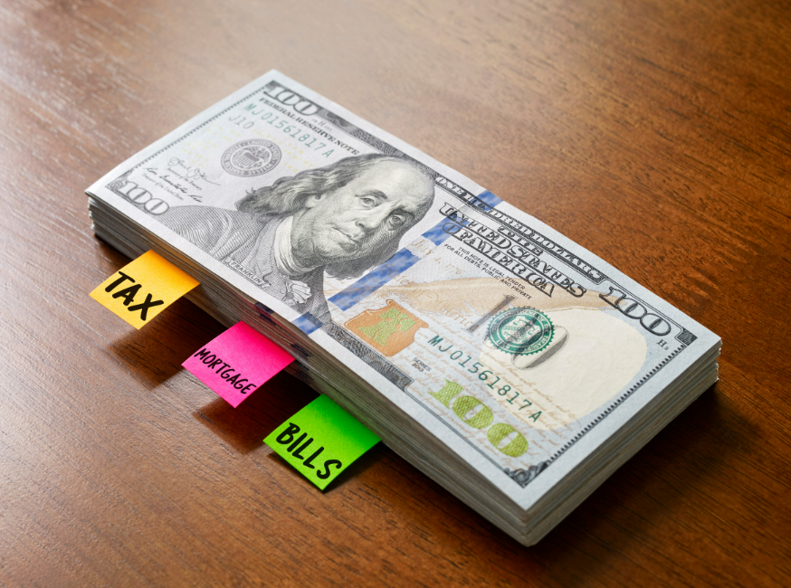
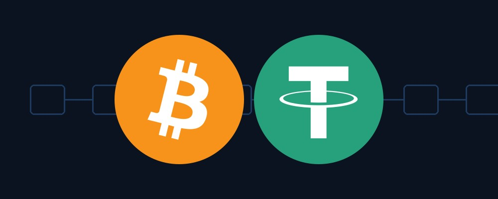
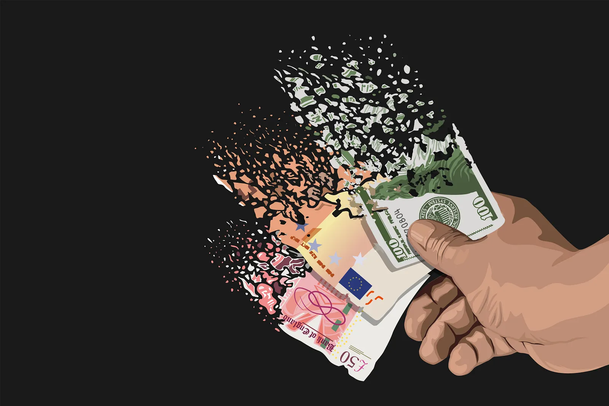

Langara · International students

# One Currency Is Not Enough

How can we protect our savings across borders?

Leo · Colombian student in Canada

<!--
Duration ~40s | Main message: personal hook + central question.
SCRIPT: Hi everyone, I'm Leo, and I'm from Colombia. When I moved to Canada for school, I learned that money in my home country does not automatically have the same purchasing power here. Today I ask: why keep all your savings in just one currency?
ANIMATION: Static cover — press Space.
NEXT: We name the currency mismatch students live with.
-->

---
layout: default
class: oc-slide
---

# Two kinds of money

Fiat money

COP · CAD · USD

<ul class="mt-2 oc-muted text-sm space-y-1 list-disc pl-4">
<li>Issued by a government and its central bank</li>
<li>Backed by trust, not gold: can lose value to inflation</li>
<li>Bank deposits can be insured (in Canada, by CDIC)</li>
</ul>

Crypto money

BTC · USDT

<ul class="mt-2 oc-muted text-sm space-y-1 list-disc pl-4">
<li>Digital, on a blockchain, not issued by a government</li>
<li>USDT aims to stay at 1 US dollar; Bitcoin swings a lot</li>
<li>Not an insured deposit: you depend on the issuer</li>
</ul>

Both are tools. Neither is risk-free.

<!--
Duration ~45s | Definitions so everyone shares the same words.
SCRIPT: Before we start, two definitions. Fiat money is what governments issue: pesos, Canadian dollars, US dollars. It is not backed by gold; its value depends on trust in the central bank, and it can lose value through inflation or a weaker exchange rate. Crypto money lives on a blockchain. Bitcoin moves a lot. Stablecoins like USDT try to stay at one US dollar, but they are not insured deposits. Both are tools, and neither is risk-free.
CLICKS: 3 — fiat card, crypto card, takeaway.
NEXT: A real example of what happens when everything sits in one place.
-->

---
layout: default
class: oc-slide
---

# What if your bank froze tomorrow?

<svg width="30" height="18" viewBox="0 0 30 18" style="display:inline-block;vertical-align:-3px;margin-right:6px;border-radius:2px"><rect width="30" height="6" fill="#D52B1E"/><rect y="6" width="30" height="6" fill="#FFFFFF"/><rect y="12" width="30" height="6" fill="#0038A8"/><circle cx="15" cy="9" r="2.4" fill="none" stroke="#0038A8" stroke-width="0.8"/><circle cx="15" cy="9" r="0.9" fill="#F4C300"/></svg>Paraguay · November 2026 The central bank seized <strong>Ueno Bank</strong>, a fast-growing digital bank.

2.9 million customers, in a country of 6.1 million

Savings in limbo. Eight executives detained.

“Paraguay seizes major digital bank tied to president, leaving millions of customers in limbo” — AP, Nov 3, 2026

My bank

⚠ ACCOUNT UNAVAILABLE

Available balance

— — —

Transfer

Withdraw

Suspended by the regulator.

One bank, one currency, one app = one point of failure.

Illustration, not a real app screen. Sources: AP via KSAT (Nov 3, 2026); La Nación (Nov 2026); Forbes Argentina (Nov 2026).

<!--
Duration ~45s | Hook: real, recent, close to home for Latin American students.
SCRIPT: Two weeks ago in Paraguay, the central bank took over Ueno, a digital bank with almost three million customers, about half the country. Overnight, people could not reach their savings. This was not a currency crash; it was a bank problem. But the lesson is the one I want to talk about today: when everything you own sits in one place (one bank, one currency) you have a single point of failure.
CLICKS: 4 (event, scale, consequence, lesson).
CAUTION: Stick to the facts; avoid political claims.
NEXT: The problem for international students.
-->

---
layout: default
class: oc-slide
---

# The problem: money across borders

I save in

COP

Family money, work at home, past savings.

I spend in

CAD

Rent, groceries, transit, daily costs.

The currency you save in may not be the currency you spend.

<strong>Finding 1:</strong> exchange-rate moves change the real value of your savings, even if you spend nothing.

<!--
Duration ~55s | Audience: Langara international students — daily costs are in CAD.
SCRIPT: Many of us earn or hold money in one currency but pay living costs in another. That gap is called currency mismatch. Saving in pesos does not guarantee the same power when you spend in Canadian dollars here.
CLICK 1: reveal takeaway line.
CLICK 2: mention this is our first research finding — currency risk.
NEXT: Show real data for three currencies.
-->

---
layout: default
class: oc-slide
mdc: false
---

# Six currencies vs the US dollar — 2025

Research question: Can managing multiple currencies help protect savings from FX swings?

<iframe src="./charts/six-currencies.html#slide-2025" class="block mx-auto rounded-lg border-0" style="width: 100%; max-width: 900px; height: 430px" title="Six currencies vs USD (2025)"></iframe>

Value of each currency in USD, index = 100 at the start of the year. Up = stronger. Source: fawazahmed0 exchange-api (daily reference rates), weekly snapshots.

<!--
Duration ~50s | Main message: currencies do not move together in 2025.
SCRIPT: Six currencies indexed against the US dollar for 2025. Each line shows whether that currency strengthened or weakened versus the dollar through the year. No click steps — walk through the chart once.
NEXT: Same view for 2026.
-->

---
layout: default
class: oc-slide
mdc: false
---

# Six currencies vs the US dollar — 2026

Research question: Can managing multiple currencies help protect savings from FX swings?

<iframe src="./charts/six-currencies.html#slide-2026" class="block mx-auto rounded-lg border-0" style="width: 100%; max-width: 900px; height: 430px" title="Six currencies vs USD (2026)"></iframe>

Value of each currency in USD, index = 100 at the start of the year. Up = stronger. Source: fawazahmed0 exchange-api (daily reference rates), weekly snapshots.

<!--
Duration ~45s | Compare 2026 path to prior year.
SCRIPT: Same six currencies for 2026 so far — patterns can differ year to year.
NEXT: BIS volatility table (Q2 2025).
-->

---
layout: default
class: oc-slide
---

# How volatile is each currency?

<table class="oc-vol w-full">
<thead><tr><th class="text-left">Currency</th><th class="text-right">FX market 2024–2026</th><th></th><th class="text-right">USDT market BIS, Q2 2025</th></tr></thead>
<tbody>
<tr><td><strong>CAD</strong> Canadian dollar</td><td class="text-right">5.2%</td><td>

</td><td class="text-right oc-muted">7.27%</td></tr>
<tr><td><strong>CHF</strong> Swiss franc</td><td class="text-right">7.9%</td><td>

</td><td class="text-right oc-muted">14.68%</td></tr>
<tr><td><strong>MXN</strong> Mexican peso</td><td class="text-right">10.9%</td><td>

</td><td class="text-right oc-muted">11.36%</td></tr>
<tr><td><strong>CLP</strong> Chilean peso</td><td class="text-right">11.5%</td><td>

</td><td class="text-right oc-muted">—</td></tr>
<tr><td><strong>COP</strong> Colombian peso</td><td class="text-right">11.9%</td><td>

</td><td class="text-right oc-muted">12.25%</td></tr>
<tr><td><strong>BRL</strong> Brazilian real</td><td class="text-right">12.1%</td><td>

</td><td class="text-right oc-muted">13.80%</td></tr>
</tbody>
</table>

● under 10% &nbsp; ● 10–12% &nbsp; ● over 12%

FX market: annualized volatility of weekly changes vs USD, Mar 2024 – Nov 2026 (fawazahmed0 exchange-api). USDT market: Aldasoro, Beltran &amp; Grinberg (2026), BIS WP 1340, Table 1 — price of USDT on crypto exchanges, a different market.

<!--
Duration ~40s | Main message: CAD and CHF are the calm ones; Latin American currencies swing more.
SCRIPT: Volatility tells you how much a currency swings. In the normal FX market, the Canadian dollar and the Swiss franc are the calmest, under 10 percent a year. The Latin American currencies swing more. The right column is from a 2026 BIS paper that measures the price of USDT on crypto exchanges: same pattern for most, but the franc looks volatile there because that crypto market is small, not because the franc is risky.
NEXT: What research says about holding more than one currency.
-->

---
layout: default
class: oc-slide
---

# What does research say?

IMF · 2006

Saving in dollars is rational

In Latin America, households hold dollars as a response to inflation uncertainty, and the habit persists.

Rennhack &amp; Nozaki, IMF WP/06/7

Journal of Finance · 2010

Some currencies work as shields

The US dollar, the euro and the Swiss franc tended to rise when world stock markets fell, so holding them lowered overall risk.

Campbell, Serfaty-de Medeiros &amp; Viceira

Our data · 2026

Timing costs real money

Converting the same CAD 9,000 cost about <strong class="oc-num-down">COP 5.2M more</strong> in the worst week than in the best week.

Weekly COP/CAD, Jan–Nov 2026

Holding more than one currency is about protection, not profit.

<!--
Duration ~60s | Evidence instead of personal strategy.
SCRIPT: This is not only my opinion. An IMF study found that Latin American families save in dollars as a rational answer to inflation uncertainty. A Journal of Finance paper showed that the dollar, the euro and the Swiss franc tended to rise when stock markets fell, so they reduce risk. And in our own data for 2026, converting the same nine thousand Canadian dollars cost five million pesos more depending on the week. Holding more than one currency is about protection, not about getting rich.
CLICKS: 3 cards + takeaway.
NEXT: Interest rates are not the whole story.
-->

---
layout: default
class: oc-slide
---

# High interest, lower value?

Scenario A · CAD 9,000 in a savings account during 2026 · measured in US dollars

January 2026

CAD 9,000

= USD 6,555

+2.5%

interest

−3.8%

CAD vs USD

November 2026

CAD 9,225

= USD 6,464

More Canadian dollars, but <strong class="oc-num-down">−1.4%</strong> in US dollars.

<strong>Finding 2:</strong> interest alone does not protect value when the currency moves. The value depends on the currency you will spend.
2.5% is a hypothetical savings rate; CAD/USD 1.373 → 1.427 (Jan 3 – Nov 14, 2026, fawazahmed0 exchange-api).

<!--
Duration ~50s | Main message: interest + FX interact.
SCRIPT: Imagine nine thousand Canadian dollars in a savings account this year. You earn two and a half percent, so you end with 9,225. Good. But the Canadian dollar lost almost four percent against the US dollar. Measured in US dollars, you went from 6,555 to 6,464: about one and a half percent less. If you will spend in Canada, that is fine. If you will spend in US dollars, you lost value. What matters is the currency you will spend.
CLICKS: 5 (start, arrows, end, result, finding).
NEXT: Scenario B — the same money, starting in US dollars.
-->

---
layout: default
class: oc-slide
---

# Scenario B: half and half, move 25%

Same CAD 9,000 · rebalance 25% only at the extremes

Start · Jan 3

rate 1.373

CAD 4,500

+

USDT 3,277

half in each currency

Move 1 · Feb 11

CAD strong · 1.3526

CAD 1,128

→

USDT 834

sell 25% of the CAD

Move 2 · Nov 14

CAD weak · 1.4271

USDT 1,028

→

CAD 1,467

sell 25% of the USDT

Rule: <strong>sell what is expensive, buy what is cheap</strong>, a little at a time.

Rates: daily reference, fawazahmed0 exchange-api. Feb 11 and Nov 14 are the 2026 extremes, so this is the best case (perfect timing, known only afterwards).
2.5% interest on the CAD part, pro-rated; 0% yield on USDT; no fees or spread; USDT is not an insured deposit.

<!--
Duration ~60s | Main message: hold both currencies and move a little at the extremes.
SCRIPT: Now the balanced way. I split my nine thousand Canadian dollars: half stays in Canadian dollars in a savings account, half goes to US dollars: 3,277 USDT. My rule is simple: I only move 25 percent, and only at an extreme. On February 11 the Canadian dollar was at its strongest of the year, so I sell 25 percent of my Canadian dollars: 1,128 become 834 USDT. On November 14 it was at its weakest, so I do the opposite: I sell 25 percent of my USDT, 1,028, and get 1,467 Canadian dollars. I always sell what is expensive and buy what is cheap. To be honest: these are the extremes of the year, so this is the best case; in real life you only know the extreme afterwards.
CLICKS: 4 (start, move 1, move 2, rule).
NEXT: Compare the three strategies.
-->

---
layout: default
class: oc-slide
---

# Which strategy protects best?

CAD 9,000 on Jan 3 · value on Nov 14, 2026

<table class="oc-vol w-full text-lg">
<thead><tr><th class="text-left">Strategy</th><th class="text-right">In CAD</th><th class="text-right">In USD</th></tr></thead>
<tbody>
<tr v-click><td><strong>A</strong> · All in CAD savings (2.5%)</td><td class="text-right">9,225</td><td class="text-right oc-num-down font-bold">6,464 (−1.4%)</td></tr>
<tr v-click><td><strong>B0</strong> · All in USDT, do nothing</td><td class="text-right oc-num-up font-bold">9,355 (+3.9%)</td><td class="text-right">6,555 (0%)</td></tr>
<tr v-click><td><strong>B</strong> · Half and half, 25% moves</td><td class="text-right oc-num-up font-bold">9,328 (+3.6%)</td><td class="text-right font-bold">6,536 (−0.3%)</td></tr>
</tbody>
</table>

This year the US dollar won, so B0 came first. If the CAD had gone up, B0 would have come last.

The balanced mix is never the worst, and close to the best, in either currency.

Half and half without any moves: CAD 9,290 / USD 6,510. The 25% moves added CAD 38. Same assumptions as the previous slide.

<!--
Duration ~45s | Main message: balance beats guessing.
SCRIPT: Here are the three strategies side by side. All in Canadian dollars lost value in US dollars. All in USDT won this year, because the US dollar went up, but if the Canadian dollar had gone up instead, it would be last. The half-and-half mix beats the savings account in both currencies and stays close to the best. That is the point: you do not need to predict the market. You need a balance.
CLICKS: 4 (A, B0, B, takeaway).
NEXT: Conversion channels.
-->

---
layout: default
class: oc-slide
---

# Cheaper, legal ways to move and hold money

Options available to international students in most countries

<table class="oc-vol w-full text-sm">
<thead><tr><th class="text-left">Option</th><th class="text-left">Best for</th><th class="text-left">Typical cost</th><th class="text-left">Protection</th></tr></thead>
<tbody>
<tr v-click><td><strong>Bank transfer</strong></td><td>Sending abroad</td><td class="oc-num-down">Most expensive: ~15% on US$200</td><td>Insured deposit</td></tr>
<tr v-click><td><strong>Digital transfer app</strong> (Wise, Remitly…)</td><td>Sending abroad</td><td>~3.5% on US$200; Wise from 0.57%</td><td class="oc-muted">Licensed, funds safeguarded</td></tr>
<tr v-click><td><strong>Multi-currency account</strong> (Wise, Revolut)</td><td>Hold USD / EUR, convert when you choose</td><td>Free to hold · ~0.5% to convert</td><td class="oc-muted">Safeguarded, not deposit insurance</td></tr>
<tr v-click><td><strong>USD bank account</strong> (where you study)</td><td>Hold dollars safely</td><td class="oc-num-up">Often no fee · can earn interest</td><td class="oc-num-up">Deposit insurance (e.g. CDIC)</td></tr>
<tr v-click><td><strong>USDC</strong> stablecoin</td><td>Dollars on crypto</td><td>Spread + network fees</td><td class="oc-muted">Not insured · authorised in EU</td></tr>
<tr v-click><td><strong>USDT</strong> stablecoin</td><td>Dollars on crypto</td><td>Spread + network fees</td><td class="oc-num-down">Not insured · off regulated exchanges in EU and Canada</td></tr>
</tbody>
</table>

Legal almost everywhere, but the rules change by country. Insured first, crypto second.

<strong>Finding 3:</strong> the channel changes how much arrives; compare the net amount at the same moment.
World average to send US$200: 6.4%; digital-only services ~3.5% vs banks ~15% (World Bank, Remittance Prices Worldwide, 2025). Wise fees as published (2026).
USDT left MiCA-licensed EU exchanges on Jul 1, 2026, and registered Canadian platforms in 2023; USDC is authorised under MiCA. Declare crypto and foreign accounts where you pay tax.

<!--
Duration ~70s | Main message: cheaper legal channels exist everywhere; insured options first.
SCRIPT: How do you move and hold money cheaply and legally, wherever you study? A bank transfer is the most expensive: on two hundred dollars, banks charge around fifteen percent on average, according to the World Bank. Digital apps like Wise or Remitly average about three and a half percent. To hold dollars or euros and convert when the rate is good, a multi-currency account like Wise or Revolut is cheap, but it is not deposit insurance. A US dollar account at a bank where you study can be free, pay interest, and be insured. Then stablecoins: USDC and USDT. USDT is my personal reference and it is legal in most places, but it was removed from regulated exchanges in the European Union this July and in Canada in 2023. USDC is the one authorised in Europe. So my rule: insured first, crypto second, and declare it where you pay tax.
CLICKS: 7 (six rows + takeaway).
CAUTION: Fees change; check live quotes before presenting numbers as current.
NEXT: Where to keep a large amount.
-->

---
layout: default
class: oc-slide
---

# Where do people keep their savings?

🏦

Nubank

One bank, one currency.

📄

CDT

Known rate, money locked.

🍁

TFSA

Tax-free, in CAD.

🐄

Cows

Real asset, hard to sell fast.

📱

iPhone

Not savings: loses value.

Class challenge: you want to move and hold <strong>CAD 9,000</strong> for a few months. Where?

<strong>A. Traditional bank</strong>
Simple and insured, higher fees and spread

<strong>B. USDT</strong>
Flexible, follows the US dollar, not insured

<strong>C. Split</strong>
Part in each

Match the currency you spend. Spread the rest.

Protecting your savings beats predicting the market · Thank you! Questions?

<!--
Duration ~1:20 | Closing slide with audience participation.
SCRIPT: Where do people keep savings? A digital bank like Nubank, a CDT, a TFSA here in Canada, cows back home, or, let's be honest, an iPhone, which is not savings at all. Each one has a currency, a risk and a level of liquidity. Quick challenge: you want to move and hold nine thousand Canadian dollars for a few months. A, B or C? Show of hands. A traditional bank is simple and your deposit is insured, but transfers and conversions usually cost more in fees and spread. USDT is flexible: you can convert when the rate is good, and it follows the US dollar. This year the Canadian dollar lost almost four percent against the US dollar, so a dollar-linked balance kept more value. But if the Canadian dollar gets stronger, the opposite happens, and USDT is not an insured deposit. That is why many people split. So my closing advice: match the currency you will spend, and spread the rest. Protecting your savings is more important than predicting the market. Thank you. Questions?
CLICKS: challenge, closing.
-->

---
layout: default
class: oc-slide
---

# References (APA 7)

Aldasoro, I., Beltran, G. A., & Grinberg, F. (2026). <em>Stablecoin flows and spillovers to FX markets</em> (BIS Working Papers No. 1340). Bank for International Settlements. https://www.bis.org/publ/work1340.htm

Campbell, J. Y., Serfaty-de Medeiros, K., &amp; Viceira, L. M. (2010). Global currency hedging. <em>The Journal of Finance, 65</em>(1), 87–121.

Rennhack, R., &amp; Nozaki, M. (2006). <em>Financial dollarization in Latin America</em> (IMF Working Paper No. 06/7). International Monetary Fund.

Fawaz Ahmed. (2026). <em>exchange-api: Free currency exchange rates API</em> [Data set]. https://github.com/fawazahmed0/exchange-api

Associated Press. (2026, November 3). Paraguay seizes major digital bank tied to president, leaving millions of customers in limbo. KSAT.

DLA Piper. (2026, April 20). <em>Canada enacts framework to regulate stablecoin in Bill C-15</em>. https://www.dlapiper.com/en/insights/publications/2026/04/canada-enacts-framework-to-regulate-stablecoin-in-bill-c15

EQ Bank. (n.d.). <em>US Dollar Account fees &amp; features</em>. https://eqbank.ca/personal-banking/savings/usd/us-dollar-account-fees-features

World Bank. (2025). <em>Remittance Prices Worldwide</em> (Issue 53). https://remittanceprices.worldbank.org

The Paypers. (2026). <em>Tether exits EU market as MiCA rules block USDT from exchanges</em>. https://thepaypers.com/

Wise. (2026). <em>Pricing and fees</em>. https://wise.com/pricing

Bank of Canada. (n.d.). <em>FXUSDCAD — External nominal indexes, daily</em> (Valet API). https://www.bankofcanada.ca/valet/

Banco de la República. (n.d.). <em>Representative market exchange rate (TRM)</em> [Data set]. datos.gov.co resource ceyp-9c7c. https://www.datos.gov.co/

Board of Governors of the Federal Reserve System. (n.d.). <em>Foreign exchange rates — H.10</em> (FRED series DEXMXUS). https://fred.stlouisfed.org/series/DEXMXUS

<!--
Optional ~30s if time remains — otherwise skip.
-->